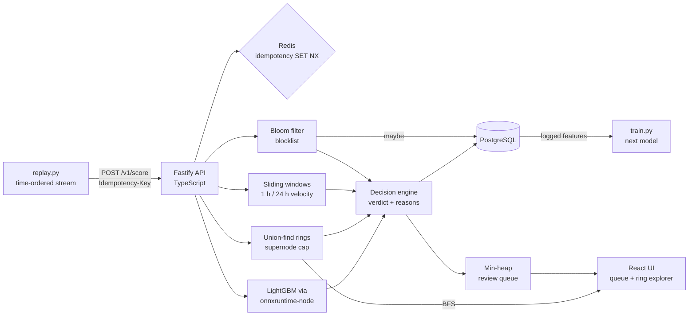
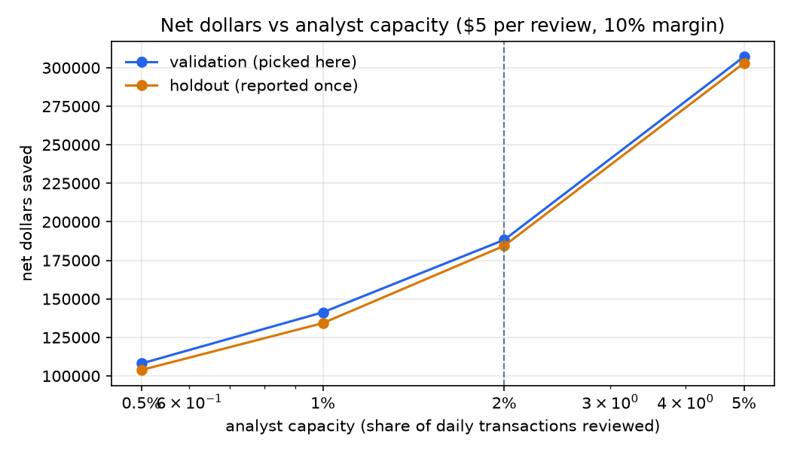

# FraudGraph

A real-time risk engine for card-not-present payments. Every transaction gets **approve, review or decline** in a few milliseconds, with reasons an analyst can read ("device linked to 7 card entities in 24 h"). It combines four signals, cheapest first: a Bloom-filter blocklist, sliding-window velocity rules, an identity graph that groups linked cards and devices into rings, and a LightGBM model served through ONNX in Node. It is built on the IEEE-CIS (Vesta) dataset of about 590,000 real anonymized e-commerce transactions, evaluated on a time-based holdout, and judged in dollars.

> **Status:** results below are on the real IEEE-CIS training data (590,540 transactions, time-based holdout of the last 42 days). Everything runs locally; the live demo, video and load test on a deployed host are not done yet.

## Architecture



Life of one request: check the idempotency key (a repeat returns the stored decision); compute the card and device entity keys; screen them with the Bloom filter and confirm any hit in PostgreSQL; update the 1 h and 24 h windows on event time; add the card–device link to the ring graph unless one side is a supernode; build the feature vector and score it; combine rule hits and the model score into a verdict with reasons; write the transaction, decision and feature vector in one PostgreSQL transaction and queue review cases.

## Results

Every number is produced by a script and collected, with the script link, in [docs/results.md](docs/results.md). Assumptions for dollars: $5 per manual review, 10% margin lost on a declined good transaction, a reviewed fraud is stopped ([`ml/assumptions.py`](ml/assumptions.py)).

### Rules vs model

<!-- results-table:start -->
Holdout, same analyst capacity for each policy (2,371 reviews, 2% of volume). From [`ml/lift.py`](ml/lift.py); details in [docs/results.md](docs/results.md).

| Policy | Reviews / declines | Recall | False-positive rate | Fraud $ stopped | Good-customer $ declined | Net $ |
|---|---|---|---|---|---|---|
| Rules only | 2,371 / 1,780 | 23.7% | 2.78% | $128,651 | $76,817 | $109,115 |
| Model only | 2,371 / 638 | 51.0% | 0.81% | $233,800 | $2,876 | $221,658 |
| Rules + model | 2,371 / 2,299 | 55.1% | 2.12% | $239,937 | $79,693 | $220,113 |
<!-- results-table:end -->

### Identity rings

<!-- rings-summary:start -->
Holdout transactions in rings of 3+ entities that include prior fraud. From [`server/scripts/ringEval.ts`](server/scripts/ringEval.ts).

| Supernode cap | Largest ring | Flagged transactions | Fraud rate when flagged | Lift over baseline |
|---|---|---|---|---|
| none | 63,586 | 22,742 | 8.26% | 2.4x |
| 50 | 22,598 | 12,649 | 10.01% | 2.9x |
| 20 | 10,042 | 7,573 | 14.04% | 4.1x |
| 10 | 5,003 | 5,438 | 15.08% | 4.4x |
| 5 | 918 | 2,721 | 16.13% | 4.7x |
<!-- rings-summary:end -->

<!-- operating-point:start -->
### Operating point (dollars, within analyst capacity)

Analysts can review 2% of daily transactions and at most 1% are auto-declined. Within that, review at model score ≥ 0.945 and decline at ≥ 0.990, picked on the validation slice to maximize net dollars at $5 per review and 10% margin. On the holdout: 40 reviews per day, recall 44.3%, false-positive rate 0.44%, net $184,464. Other capacities and a doubled margin are in [docs/results.md](docs/results.md). Produced by [`ml/costs.py`](ml/costs.py).


<!-- operating-point:end -->

### Latency

Scoring inside the API (blocklist, windows, ring graph, model; excluding the database write): p50 0.62 ms, p95 2.31 ms. End to end on a MacBook (Apple M1), 20 concurrent clients: 651 requests/s, p95 59 ms. ONNX model alone: p95 0.07 ms. Details and commands in [docs/load.md](docs/load.md); the deployed-host run is still to do.

## Quick start

```
cp .env.example .env          # set PG_PASSWORD
docker compose up -d --build  # Postgres, Redis, API + analyst UI on http://localhost:3000
```

The stack starts empty and scores with rules only until a model is trained. To run the whole pipeline locally (Python 3.11+, Node 20):

```
make venv                     # Python environment from requirements.txt
make data                     # real data: needs ~/.kaggle/kaggle.json and accepted competition rules
#   or: make sample           # synthetic stand-in with the same columns
make profile parquet split entities blocklist
make infra migrate && make api          # API on the host (separate terminal)
make replay-all features baseline       # replay train, gap, holdout; rules-only baseline
make rings train evaluate costs onnx    # ring lift, model, cost thresholds, ONNX + parity
make reset-state && make api            # restart with the model, then:
make replay-all lift                    # rules vs model vs both
make web                                # analyst UI on http://localhost:5173
```

## Data and its limits

IEEE-CIS Fraud Detection (Kaggle, 2019), prepared by Vesta Corporation: about 590,000 training transactions, under 3.5% fraud, about 144,000 with identity rows. Raw files are never committed; download them with `make data` after accepting the competition rules.

- **Masked columns.** Most fields (card2–card6, C, D, id_*) are anonymized, so many features cannot be explained in business terms.
- **No ring labels.** Rings are judged by how concentrated fraud is inside them (lift), not against ground truth.
- **Labeling rule.** The competition host explained that after a chargeback, later transactions on the same card, account, email or address were also labeled fraud. That is why the blocklist and entity keys work so well here, and it flatters them compared with a live system.
- **Relative time.** TransactionDT is seconds from an unknown start. A day is 86,400 seconds; there are no calendar dates.

## Design decisions and trade-offs

- **Time split with a gap.** Train on the first 80% of the timeline minus a week, hold out the last 20%. A random split would leak each card's future into training. ([`prep/split.py`](prep/split.py), [docs/splits.md](docs/splits.md))
- **Labels only when they would exist.** Blocklist entries apply from first fraud plus a 7-day label delay, in event time, so replays never use a chargeback before it arrived.
- **Entity keys as a hypothesis.** `card1|addr1|floor(day − D1)` approximates one customer; [docs/entities.md](docs/entities.md) measures label consistency per key. Python and TypeScript implementations are checked against each other on 1,000 rows.
- **Supernode cap.** A device string like "Windows 10 / Chrome / 1920x1080" would merge thousands of strangers into one ring. Nodes with more than 50 neighbors are cut, and union-find (which cannot delete edges) is rebuilt without them.
- **In-memory windows, Redis for idempotency.** In-memory windows are about 1,000x faster than Redis sorted sets ([docs/velocity.md](docs/velocity.md)); the cost is single-instance state, rebuilt from PostgreSQL on restart.
- **Training reads serving logs.** The API logs the exact feature vector it used; the model trains on those logs, and an ONNX parity test checks Python and Node agree on 1,000 rows. Both guard against training-serving skew.
- **Thresholds by dollars.** Review and decline cut-offs maximize net dollars on the validation slice, then are reported once on the holdout.

Drafts of the write-up, demo outline and resume bullets are in [docs/writeup.md](docs/writeup.md).

Hand-written data structures, each with tests: [Bloom filter](server/src/ds/bloomFilter.ts), [union-find](server/src/ds/unionFind.ts), [sliding window](server/src/ds/slidingWindow.ts), [min-heap](server/src/ds/minHeap.ts), BFS in the [ring graph](server/src/graph/rings.ts).

## Reproducing every number

| Number | Script | Output |
|---|---|---|
| Data profile | [`prep/profile_data.py`](prep/profile_data.py) | [docs/data_profile.md](docs/data_profile.md) |
| Split sizes and fraud rates | [`prep/split.py`](prep/split.py) | [docs/splits.md](docs/splits.md) |
| Entity-key consistency | [`prep/entity_check.py`](prep/entity_check.py) | [docs/entities.md](docs/entities.md) |
| Ring lift with and without cap | [`server/scripts/ringEval.ts`](server/scripts/ringEval.ts) | [docs/results.md](docs/results.md) |
| Rules-only baseline | [`ml/evaluate_decisions.py`](ml/evaluate_decisions.py) | [docs/results.md](docs/results.md) |
| Holdout PR-AUC, recall at 1% FPR | [`ml/evaluate.py`](ml/evaluate.py) | [docs/results.md](docs/results.md) |
| Operating point, cost curve | [`ml/costs.py`](ml/costs.py) | [docs/results.md](docs/results.md) |
| Rules vs model vs both | [`ml/lift.py`](ml/lift.py) | this README, [docs/results.md](docs/results.md) |
| Bloom filter false-positive rate | [`server/test/bloomFilter.test.ts`](server/test/bloomFilter.test.ts) | CI output |
| Velocity: in-memory vs Redis | [`server/scripts/benchVelocity.ts`](server/scripts/benchVelocity.ts) | [docs/velocity.md](docs/velocity.md) |
| Model latency | [`server/scripts/benchModel.ts`](server/scripts/benchModel.ts) | [docs/results.md](docs/results.md) |
| Load test | [`load/k6-score.js`](load/k6-score.js) | [docs/load.md](docs/load.md) |

## Repository layout

```
prep/      load, profile, entity keys, split, blocklist (Python)
replay/    streams transactions to the API in time order
server/    Fastify API: ds/ (Bloom, union-find, windows, heap), entities/, rules/, graph/, model/, decision/, migrations/
ml/        train, evaluate, costs, ONNX export, lift
web/       React + Vite + Tailwind + Cytoscape.js analyst UI
load/      k6 load test
docs/      generated results and notes
```

## License

MIT
